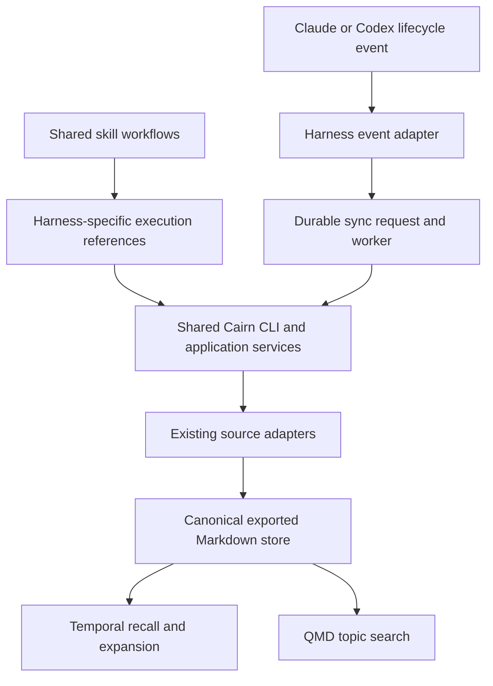

# Full Codex support: architecture and implementation plan

Status: proposed implementation plan; no implementation is implied by this document.

Research and repository inspection date: 2026-10-16.

Target: one feature PR delivering working Codex support through GitHub installation, while preserving Claude support.

## 1. Objective and agreed decisions

Cairn will support Claude and Codex through one repository, one CLI, shared skill workflows, and host-specific adapters and packaging. Installation, runtime functionality, and automatic synchronization are one deliverable. An installable plugin whose recall or hooks do not work does not satisfy this plan.

The user explicitly selected the following direction:

| Decision | Required outcome |
| --- | --- |
| Shared implementation | Keep the CLI, export pipeline, store, search, and workflow logic common. |
| Adapter architecture | Isolate harness-specific tools, lifecycle events, session identity, and installation behavior. |
| Shared skills | Maintain one set of workflows, with small references translating operations for Claude and Codex. |
| OpenAI packaging | Add a portable root `plugin.json` and `.agents/plugins/marketplace.json`; retain the Claude manifests. |
| OpenAI extension | Put host-specific manifest settings under `extensions.com.openai`. |
| Onboarding | Connect the existing setup skill through `onboardingSkill`. |
| Explicit setup | Preserve Claude's explicit invocation behavior and add Codex's `allow_implicit_invocation: false` policy. |
| Shared-store recall | Query Cairn's exported documents across sources instead of reading Claude's native store directly. |
| Automatic synchronization | Implement and test the Codex session hook in this PR. Cron is recovery and periodic maintenance, not a substitute for the hook. |
| Distribution | Support installation from the GitHub repository's marketplace. |
| Public directory | Defer OpenAI public-directory submission, ZIP preparation, and publishing review. |
| Completion | Verify a clean installation and actual host lifecycle, as well as automated tests. |

### Scope

Deliver setup, source export, automatic session synchronization, QMD search, temporal recall, expansion, notes/status updates, session resume, version diagnostics, and installation/update instructions for Codex. Exercise the corresponding Claude workflows for regressions.

Existing source integrations remain available independently of the active harness. A user working in Codex must be able to recall Claude sessions, and a user working in Claude must be able to recall Codex sessions.

Do not add an MCP server merely to package the existing CLI workflows. Do not create separate Claude and Codex engines or duplicate the skills. Do not introduce a second authoritative database for session content. Operating-system claims must match the environments actually tested; this work does not silently promise a new Windows replacement for the existing cron-based setup.

## 2. Research findings and their implications

The findings below came from official documentation fetched during the discussion, direct repository inspection, and read-only CLI help commands. Proposed designs later in this document are Cairn design decisions, not claims that the documentation prescribes this architecture.

### 2.1 Skills, plugins, and marketplaces

OpenAI's changelog records Codex plugins launching on 2026-03-25. That historical announcement used `.codex-plugin/plugin.json`. The current packaging guide recommends a portable root `plugin.json` using the Agent Plugins schema, with the older manifest retained as a compatibility path. Prefer the current guide when implementing the new package. [OpenAI changelog](https://learn.chatgpt.com/docs/changelog#build-and-install-plugins-in-codex), [current packaging guide](https://developers.openai.com/plugins/build/plugins)

Both Claude and Codex use `SKILL.md` workflows. A plugin groups those workflows and related resources into an installable package. Local standalone skills are also supported, but plugin distribution fits Cairn's four related workflows. Codex documents repository/user `.agents/skills` locations, `/skills` and `$` invocation, and optional `agents/openai.yaml` metadata. [Claude skills](https://code.claude.com/docs/en/skills), [Codex skills](https://learn.chatgpt.com/docs/build-skills)

Claude's documented layout places its manifest under `.claude-plugin/` and the skills at the plugin root. A Git-hosted `.claude-plugin/marketplace.json` supplies installation sources. Cairn's existing packaging follows that approach. [Claude manifest reference](https://code.claude.com/docs/en/plugins-reference), [Claude marketplace guide](https://code.claude.com/docs/en/plugin-marketplaces)

OpenAI documents `.agents/plugins/marketplace.json`, Git marketplace registration, an onboarding skill field, and settings under `extensions.com.openai`. Root package paths and manifest references must follow its path rules. The inline OpenAI extension and compatibility overlay are not merged. The plan uses one OpenAI settings location. [OpenAI packaging guide](https://developers.openai.com/plugins/build/plugins)

### 2.2 GitHub distribution versus the public directory

These are separate routes:

| Route | Cairn decision |
| --- | --- |
| GitHub/local marketplace | Implement now, including automatic sync hooks. |
| OpenAI public plugin directory | Defer submission and publication. |
| Standalone skill installation | Useful for experiments, but not the supported full Cairn installation. |

OpenAI's Claude migration guide supports converting a qualifying Claude skills archive through its submission portal. It also instructs authors to remove lifecycle hooks for public submission. That restriction does not justify removing hooks from this PR's GitHub installation. [Claude-to-OpenAI migration guide](https://developers.openai.com/plugins/guides/submit-claude-plugin)

The public submission process includes identity verification, package checks, review, and publication. Skill/metadata updates require a new ZIP. Local-execution plugins have additional guidance; skills-only packages can declare `requires_local_executor`. Local MCP submissions have a separate eligibility restriction. Cairn currently needs no MCP conversion. [Submission guide](https://developers.openai.com/plugins/deploy/submission), [desktop-only plugins](https://developers.openai.com/plugins/deploy/desktop-only)

If public distribution is pursued later, revisit those requirements then. A potential future directory artifact must not weaken the GitHub-distributed feature set agreed here.

### 2.3 Hook constraints that affect the implementation

The current Codex hook reference establishes the following:

- `SessionEnd` is supported for the main thread and has specific session-ending semantics; merely switching conversations does not immediately fire it.
- It runs synchronously even if `async` is set.
- Its default timeout is one second and its maximum is three seconds.
- Unfinished host-managed background hooks are cancelled when the session ends.
- Non-managed hooks require trust review before they run.

Consequently, Cairn must hand off durable work quickly and verify the worker's lifetime independently of the host's hook process. A larger timeout or `async: true` is not a solution. [Codex hooks](https://learn.chatgpt.com/docs/hooks)

OpenAI's packaging guide explicitly describes bundled hooks for manually installed Codex desktop plugins. It also documents automatic hook-file discovery and an explicit override. Cairn will select the Codex hook file explicitly, preventing accidental loading of its Claude configuration. CLI loading and fallback registration remain live-test requirements. [Bundled hook documentation](https://developers.openai.com/plugins/build/plugins#bundled-mcp-servers-and-lifecycle-hooks)

### 2.4 Authoring practices retained from the research

Anthropic recommends concise skills, progressive disclosure, specific descriptions, concrete examples, explicit dependency checks, and evaluations based on real failure cases. Its suggested body size is under 500 lines. It recommends establishing representative scenarios before expanding instructions. Cairn should preserve its focused workflows and move host mechanics into references. [Anthropic skill authoring best practices](https://platform.claude.com/docs/en/agents-and-tools/agent-skills/best-practices)

OpenAI likewise recommends focused workflows, clear inputs and outputs, supporting references, and testing both activation and results. Test direct requests, indirect requests, missing inputs, unrelated requests, and failure cases. In particular, Cairn's broad search triggers such as “find” and “look up” should not capture unrelated web or code searches. [OpenAI skill authoring](https://developers.openai.com/plugins/build/skills)

Retain deterministic operations in the CLI. The skill should orchestrate documented commands and verify outcomes; it should not recreate parsers, configuration mutations, or process supervision in prose. Skill instructions must respect the user's explicit intent and the actual host's available tools.

### 2.5 Locally verified command syntax

The installed CLI reported `codex-cli 0.160.0`. The following read-only commands were inspected:

```text
codex --version
codex plugin --help
codex plugin add --help
codex plugin marketplace add --help
codex resume --help
```

The help output confirmed:

- `codex plugin marketplace add` accepts a local path, GitHub shorthand, or Git URL, with optional ref/sparse settings.
- `codex plugin add` accepts `PLUGIN@MARKETPLACE` or a plugin plus `--marketplace`.
- `codex resume` accepts a session ID.

This establishes syntax on the inspected version, not a successful Cairn installation, minimum supported version, or verified hook execution. Those require implementation and acceptance testing. OpenAI also documents marketplace registration and plugin browsing. [Marketplace commands](https://developers.openai.com/plugins/build/plugins#add-a-marketplace-from-the-cli), [official plugin installation example](https://developers.openai.com/learn/developers-codex-plugin)

## 3. Repository baseline

The inspected working tree was clean. Cairn's Claude plugin manifest declared version `2.3.0`. These are the relevant seams and gaps:

| Area | Existing implementation | Consequence |
| --- | --- | --- |
| Source abstraction | [`ConversationSource`](../src/cairn/sources/base.py) shares export assembly, listing, mutations, and CLI behavior. | Extend this abstraction rather than creating a parallel Codex pipeline. |
| Parsed data | [`schema.py`](../src/cairn/schema.py) defines shared `SessionData` and `Message` shapes. | Reuse normalized source output; tighten only the metadata contracts this work needs. |
| Exported listing | [`listing.py`](../src/cairn/listing.py) already reads Markdown/frontmatter across sources. | Build the shared recall store on this foundation. |
| Rendering | [`rendering.py`](../src/cairn/rendering.py) renders common role sections and available message timestamps. | Expansion can consume one exported representation. |
| Temporal recall | [`recall.py`](../src/cairn/recall.py) directly scans Claude JSONL and uses the Claude collection. | Replace native-store querying with shared-store queries. |
| Codex exporter | [`sources/codex.py`](../src/cairn/sources/codex.py) parses rollouts and exports Markdown. | Existing functionality can supply the shared store. Preserve its logical-session deduplication behavior. |
| Session identity | `CodexSource` inherits the base class's `CLAUDE_SESSION_ID`. | Notes/status changes need correct harness-aware identity resolution. |
| Export metadata | Source heads have different IDs/counts and omit some normalized project/time fields. | Introduce a common queryable metadata contract and upgrade older exports. |
| Setup skill | [`skills/setup/SKILL.md`](../skills/setup/SKILL.md) requires `AskUserQuestion`, `Monitor`, and background Bash semantics. | Translate capabilities through harness references. |
| Skill invocation | Skills refer to Claude slash commands; setup uses Claude-only invocation metadata. | Add Codex invocation guidance and explicit-only policy. |
| Hook | [`hooks/hooks.json`](../hooks/hooks.json) runs `cairn sync --hook`, asynchronously, with a 30-second timeout. | Keep host-specific configuration and move work out of the short Codex callback. |
| Hook selection | [`sync.py`](../src/cairn/sync.py) enables Claude by default for hook mode and excludes Codex. | Select the originating source explicitly while respecting configuration. |
| Sync status | `sync.main` logs failures without consistently propagating a failing result. | Worker completion must distinguish successful sync from failure. |
| Version diagnostics | [`admin.py`](../src/cairn/admin.py) discovers the Claude manifest via `CLAUDE_PLUGIN_ROOT`. | Recognize both package layouts and render correct update instructions. |
| Release checks | [`test_plugin_manifest.py`](../tests/test_plugin_manifest.py) and [`release.yml`](../.github/workflows/release.yml) cover the Claude manifest. | Validate both manifests against the engine version. |
| Version-bump trigger | [`ci.yml`](../.github/workflows/ci.yml) watches existing user-facing paths. | Include the new root manifest, Codex catalog, and shared references in the release-bump trigger. |
| Runtime | [`pyproject.toml`](../pyproject.toml) keeps the engine standard-library-only, with an optional Granola dependency. | Avoid introducing a framework or queue service for this change. |

The existing architecture uses inheritance where it removes orchestration duplication, and composition/typed contracts for data processing. Follow that distinction. A class hierarchy is useful only where implementations genuinely vary.

## 4. Architecture

### 4.1 Source and harness are independent dimensions

A source describes where information originated. A harness describes the environment currently executing Cairn's workflows.

Examples:

- Codex executes the recall skill and reads exported Claude, Codex, and Cursor sessions.
- Claude executes setup and enables the Codex source even if Codex is not the active agent.
- A Codex hook identifies a Codex session for export; the shared worker handles persistence and indexing.

Do not encode “active harness equals only searchable source.” Do not place host tool-selection logic in transcript parsers.



### 4.2 Core responsibilities

The shared core owns:

- Export orchestration and source configuration.
- Canonical document assembly and atomic persistence.
- Session-store queries and ID resolution.
- Temporal filtering and bounded expansion.
- Annotation preservation and mutation behavior.
- Sync job persistence, coordination, execution, and status.
- QMD collection registration and index refresh.
- Version comparison and common diagnostic output.

Host adapters provide normalized inputs and narrowly scoped behavior. Avoid repeated host-name conditionals across the core.

### 4.3 Python harness contract

Introduce `src/cairn/harnesses/` with a small protocol or abstract base plus Claude and Codex implementations. Use data descriptors for fixed values and methods for behavior.

| Responsibility | Common contract | Host-specific implementation |
| --- | --- | --- |
| Hook decoding | Produce a normalized session event. | Interpret actual event names, IDs, paths, and working directory. |
| Session identity | Resolve a specific source/session or return unavailable/ambiguous. | Use verified host metadata and supported environment variables. |
| Package discovery | Supply candidate manifest locations and installation identity. | Recognize the host's package layout and available context. |
| Update instructions | Describe how to update the plugin component. | Claude versus Codex commands or supported UI. |
| Resume | Construct an argument vector for a selected native session. | `claude` or `codex` launch conventions. |

An illustrative normalized event contains `harness`, `source`, `session_id`, `transcript_path`, `cwd`, and `event`. It is data, not executable shell text.

Prefer explicit session IDs and explicit host selection when the caller knows them. Detection is a convenience, not permission to guess. Do not trust `CLAUDE_PLUGIN_ROOT` alone as proof of the active harness: OpenAI documents that compatibility variables can also be present in its hook environment.

Keep resume selection and command construction separate from launching an interactive terminal. A skill must not hang its own shell session by blindly opening a nested interactive agent. Test terminal invocation and give the user the appropriate launch action in other clients.

### 4.4 Shared source registry

Reuse or consolidate the source descriptors already spread across CLI dispatch and sync bindings. The registry should expose collection identity and capabilities without eagerly importing every source's native dependencies.

Source-specific parsing remains in `sources/`. Add targeted-session export capability for Claude and Codex so a hook need not scan and export every source. Sources without that capability should report it explicitly; do not give all sources a misleading no-op implementation.

## 5. Skills: shared workflow with harness adapters

### 5.1 Composition rather than pretend inheritance

There is no executable class-inheritance mechanism in `SKILL.md`. Implement the same separation using shared workflow instructions and explicitly loaded adapter references.

Keep the existing four workflows under `skills/`. Introduce shared packaged references such as:

```text
references/harnesses/
  contract.md
  claude.md
  codex.md
```

Each workflow reads the relevant reference only when it needs host-specific execution. Resolve references from the skill/package location, not the user's repository. All referenced resources must ship inside the plugin and remain available after installation into a cache. Manifest path restrictions and Markdown resource references are separate concerns; validate both.

The adapter references describe concrete available tool usage. They must not define fictional tools such as `ask_user()` and imply the harness will execute them automatically.

### 5.2 Capability mapping

| Shared operation | Claude reference | Codex reference |
| --- | --- | --- |
| Ask for missing configuration | Use `AskUserQuestion` where available. | Use the available user-input tool; otherwise ask in ordinary conversation. |
| Execute a command | Use `Bash`. | Use the exposed shell execution tool; in the inspected environment this is `exec_command`. |
| Start long-running work | Use supported background execution. | Retain the execution session/process handle from shell execution. |
| Observe work | Use `Monitor` where available and inspect the background command's result. | Poll the process session, such as with `write_stdin`, and read bounded log output. |
| Read/edit files | Use the host's file tools. | Use available file tools, shell reads, and patch operations. |
| Verify completion | Check process exit status and functional output. | Apply the same success criteria. |

These tool names are environment examples, not a guarantee that every Codex client exposes identical tools. A synchronous user-input tool may be mode-limited. The reference must adapt to availability without inventing a response or interpreting elapsed time as approval.

Shared instructions say what to accomplish: collect settings, run installation, start embedding, monitor progress, verify results. The references say how to execute those actions in the host. CLI commands remain the authority for flags and options.

### 5.3 Setup behavior

Preserve the full existing setup outcome:

1. Inspect prerequisites and collect only missing choices.
2. Install the isolated CLI, including the optional Granola extra when selected.
3. Write configuration through the CLI and resolve executable paths.
4. Export the selected sources and register collections.
5. Complete the initial embedding operation, observing exit status and progress.
6. Configure automatic synchronization and periodic maintenance.
7. Verify a real query and report operational status.

Keep setup explicit in both products. Add the following proposed file:

```yaml
# skills/setup/agents/openai.yaml
policy:
  allow_implicit_invocation: false
```

This policy is documented by OpenAI. Onboarding should invoke the same packaged setup workflow when the user runs setup; it must not become a separate implementation. [Codex skill policy](https://learn.chatgpt.com/docs/build-skills#optional-metadata)

Remove instructions that allow setup only through the literal Claude command `/cairn:setup`. Document the appropriate invocation per host. Keep Claude-specific frontmatter as applicable, but do not assume it grants Codex permissions or controls Codex invocation.

A process launch is not completion. Setup succeeds only when the index is populated, a representative query returns expected content, and hook readiness is accurately reported. No-data installations should receive an honest empty-data outcome rather than invented search results.

## 6. Shared session store and temporal recall

### 6.1 Canonical data flow

```text
Native source → source adapter → exported Markdown → shared session store → recall
                                                  └→ QMD → topic search
```

The exported Markdown remains authoritative for Cairn's read workflows. QMD is a derived search index. The shared session store is an interface over those documents, not a new independently maintained copy of the corpus.

Create a store module, initially backed by the existing listing/frontmatter helpers. Give it operations for enumerating records, filtering them, resolving a session reference, and reading bounded content. A typed `SessionRecord` is suitable at this boundary.

### 6.2 Metadata contract

Define an additive, versioned metadata contract containing:

- Originating source and full native session ID.
- Title and canonical document path.
- Project/repository identity and working directory when known.
- Start timestamp and last activity, with timezone/precision information where needed.
- Total message count and user-message count as distinct concepts.
- Existing annotations and status.

Do not silently reinterpret the current `messages` field: source implementations currently count different things. Preserve existing source-specific fields where required for compatibility, and expose a common record shape to readers.

Existing files may not have enough information for precise project or date matching. Read them conservatively, surface material missing metadata, and upgrade them when native data is available. Never invent a project or timestamp solely to make a record fit a filter.

### 6.3 Query semantics

Preserve the date-expression grammar and existing project/all-project options. Add source filtering and include source identity in output.

The intended temporal behavior is “sessions with recorded activity in the requested period.” Use exported message timestamps where available, with start/last timestamps as useful metadata and prefilters. A session's start-to-last span alone does not prove activity on every intervening day. Define and test a conservative fallback for older/date-only records, and disclose reduced precision when it affects a result.

Preserve the existing documented timezone behavior unless an explicit migration is necessary. Make timezone selection and boundaries visible in tests; do not silently change UTC-based behavior to the machine timezone. Cover midnight, daylight-saving transitions where applicable, and sessions spanning days.

Project filtering uses normalized metadata. It must not assume Claude directory slugs are universal or silently expand to unrelated projects when no match exists.

Session identity is a source-qualified full ID. Continue accepting convenient unique prefixes, but detect collisions across and within sources. An ambiguous prefix must fail with actionable choices. `expand` resolves the same identity used by listing.

Chronological recall covers configured conversation sources with meaningful dates, including meetings where supported. Notes and mirrored service docs remain searchable through QMD; do not invent session metadata for arbitrary Markdown. Message-count filtering must not accidentally exclude meetings whose source has no comparable count.

### 6.4 Expansion

Expansion reads the exported representation and uses the shared renderer's section contract. It must be bounded and respect code fences and embedded headings instead of treating arbitrary transcript text as structural metadata.

Preserve notes and useful annotations in the expanded view. Retain source-specific information already present in the document. Eliminate the need for recall to understand each native JSONL or SQLite format.

### 6.5 Freshness and metadata migration

Provide an explicit refresh-before-query option, provisionally `cairn recall list ... --refresh`. The skill uses it for recent/live history when necessary. Refresh calls the existing source adapters for the relevant configured sources and window, then queries the common store.

This export-only refresh must not require an embedding run or QMD availability. It should distinguish a failed refresh from a successful empty result, and report when the displayed store is stale.

Version the exported metadata. Incremental export must consider schema version as well as native-file changes, otherwise unchanged transcripts will never gain the fields recall needs. Preserve user annotations during re-export. If the native source is gone, keep the existing document and expose its limitations rather than deleting it.

Add atomic replacement for exports and coordinate it with annotation mutations. Atomic rename alone prevents partial reads but does not prevent a concurrent writer from losing a newly added note.

## 7. Automatic synchronization and lifecycle integration

### 7.1 Required behavior

Ending a Codex session should trigger prompt export and index refresh without waiting for the hourly cron. The existing Claude behavior must remain functional.

Host-specific event timing remains the host's responsibility. Cairn cannot promise that changing tabs ends a Codex session. Document the actual trigger and test a real terminating lifecycle event.

### 7.2 Shared hook entry point

Introduce a common hook command, provisionally:

```text
cairn hook handle --harness claude
cairn hook handle --harness codex
```

The host supplies its event on standard input. These command names are proposed implementation interfaces, not existing commands.

The entry point:

1. Validates and normalizes the event through the selected adapter.
2. Checks the originating source's configuration and hook policy.
3. Persists a compact sync request atomically.
4. Starts or wakes the shared worker.
5. Returns within the host's callback budget.

Use the transcript/session supplied by the event. Do not reuse a guessed active session, scan unrelated sources unnecessarily, or depend on a transcript's filename prefix as its full identity.

### 7.3 Worker design

Use a small standard-library implementation with durable request files and process coordination. Do not introduce Redis, a queue service, or a permanent daemon without demonstrated need.

The worker:

- Claims pending requests under a documented locking protocol.
- Exports the targeted session using its source adapter.
- Registers any missing QMD collection and refreshes the index.
- Records success, failure, and useful bounded diagnostics.
- Preserves recoverable work for retry after failure or interruption.

Coalesce duplicate events by source/session while retaining the newest required state. Test the race where a new request arrives as the worker exits. Coordinate hook, cron, manual refresh, and annotation writes; serialize shared index updates where needed. Lock cleanup must not strand future work after a crash.

Keep embeddings out of the hook path. Periodic sync can drain pending work, update other sources, and maintain embeddings. It remains a recovery path rather than the normal mechanism for completed Codex sessions becoming searchable.

### 7.4 Process lifetime and bootstrap

Persist the request before attempting process launch. Separate “queued,” “running,” and “completed” states. Return a failure when the event cannot be persisted or dispatch cannot be established; never label a merely queued request as successfully indexed.

The worker must be independent of the host-managed background-hook lifecycle. Verify detachment with a real Codex shutdown/archive event and with subprocess-level tests that terminate the parent. Do not assume a background shell operator is sufficient.

Resolve the installed engine reliably from a clean host environment, including limited PATHs and plugin cache locations. Setup should record or install the necessary absolute launcher information. The exact minimal launcher and detachment mechanism are feasibility-step outputs, constrained by the supported operating systems and the three-second callback budget.

If ordinary detachment does not survive the tested runtime, implement an appropriate supervised handoff within this PR. Do not mark the feature complete using cron-only recovery.

### 7.5 Hook configuration and trust

Retain `hooks/hooks.json` for the Claude configuration and add a separate Codex configuration such as `hooks/codex.json`. Explicitly point the OpenAI extension at the latter. Avoid duplicate registration through default discovery and explicit declarations.

Test bundled hook discovery in Codex desktop and CLI. Where CLI requires user-level registration, setup must add only a Cairn-owned entry, preserve unrelated configuration, and support idempotent update/removal. If bundled discovery works, avoid installing an additional global copy.

Respect the host's hook-trust flow. Setup and diagnostics should distinguish installed files, registered hooks, trust state when inspectable, and observed execution. If trust cannot be inspected programmatically, say so and verify through the host rather than reporting readiness from file existence.

### 7.6 Existing policy compatibility

Preserve `sync.enabled` and explicit `on_hook` preferences. An originating Codex hook must default to the Codex source, and an originating Claude hook to Claude; an explicit disabled setting still wins.

Define a compatibility path for existing `cairn sync --hook` users rather than silently changing its meaning. Move both packaged hooks to the new explicit-host entry point. Update config examples, help text, and migration notes together.

## 8. Session operations and diagnostics

### 8.1 Correct current-session selection

Fix the inherited Claude environment-variable assumption in the Codex source. Explicit IDs take precedence. Host-provided metadata must map to the intended native source/session. If several sessions are possible, refuse to mutate until the target is unambiguous.

Test notes, close, and log operations with Claude and Codex active simultaneously. Include colliding prefixes and a Claude environment variable present while the requested source is Codex.

### 8.2 Resume

Share selection logic and delegate launch-command construction to the relevant harness adapter. Add the Codex equivalent of the user-facing resume workflow where supported by the inspected CLI. Preserve the source identity of the selected record, so recalling a Claude session from Codex does not attempt to resume it as a Codex session.

Verify supported flags on the installed/tested client. Capability differences must be explicit rather than implemented as commands that silently do nothing.

### 8.3 Doctor and failure reporting

Extend diagnostics to report:

- Engine and relevant plugin versions, with host-specific update instructions.
- Enabled sources, stores, executable paths, and exported-data readiness.
- Hook registration/readiness and the most recent observed execution when available.
- Pending/running/failed sync work and actionable errors.
- QMD collection and index state.

Normalize sync result propagation. A failed export or index refresh must produce an observable failure even when other sources continue successfully. Retain the useful isolation property that one failing source does not prevent unrelated exports.

## 9. Packaging, installation, updates, and removal

### 9.1 Proposed repository layout

```text
cairn/
  plugin.json                         # New portable manifest
  .agents/plugins/marketplace.json     # New Codex marketplace
  .claude-plugin/
    plugin.json                       # Existing Claude manifest
    marketplace.json                  # Existing Claude marketplace
  skills/
    setup/
      SKILL.md                        # Shared setup workflow
      agents/openai.yaml              # Codex invocation policy
    cairn/SKILL.md
    recall/SKILL.md
    search/SKILL.md
  references/harnesses/
    contract.md
    claude.md
    codex.md
  hooks/
    hooks.json                        # Claude entry point
    codex.json                        # Codex entry point
    ...                               # Minimal launcher if required
  src/cairn/
    harnesses/                        # Host adapters and registry
    sources/                          # Existing native-data adapters
    store.py                          # Shared exported-session read model
    hooks.py                          # Normalized hook entry point
    jobs.py                           # Durable worker coordination
    recall.py
    sync.py
    ...
  tests/
  docs/codex-support-plan.md
```

New module names are illustrative boundaries. Consolidate small pieces if that produces a clearer implementation; preserve the separation of responsibilities.

### 9.2 Manifest responsibilities

The root manifest carries Cairn's identity and release version. The proposed OpenAI extension connects the shared onboarding skill and Codex hook configuration. The fragment below is illustrative, not a complete validated manifest:

```json
{
  "extensions": {
    "com.openai": {
      "onboardingSkill": "./skills/setup/SKILL.md",
      "hooks": "./hooks/codex.json",
      "requires_local_executor": true
    }
  }
}
```

The marketplace should retain the `cairn` identity and resolve the repository-root plugin using the documented source format. Add any required catalog policy/category metadata during schema validation. Do not assume the existing Claude catalog can simply be renamed without checking its schema.

Both packages load the same skills and supporting files. Keep version checks authoritative in the engine and manifests; do not introduce unnecessary duplicate version pins in marketplace entries.

### 9.3 Installation target

The intended GitHub instructions, after the implementation is released, are:

```bash
codex plugin marketplace add shavvimal/cairn
codex plugin add cairn@cairn
```

Then run Cairn's setup through the supported onboarding/skill selection flow. Setup installs the CLI, configures selected sources, completes the initial index, and verifies automatic synchronization readiness.

For development, use an isolated local marketplace and temporary configuration. For release verification, test an actual Git-backed source/ref containing the candidate implementation. Installing the current remote default branch cannot validate unpushed local changes. Publishing a branch or release is a separate action from local testing and must follow the user's authorization at execution time.

### 9.4 Updates and removal

The plugin and Python engine still update through separate mechanisms. Document and test both. Verify the appropriate marketplace refresh/plugin update commands on the tested CLI version rather than copying Claude's commands into Codex instructions.

Update `doctor` and release checks for both manifests. Extend CI's user-facing change detection to include `plugin.json`, `.agents/plugins/**`, and `references/**`, as well as the existing skill, hook, and engine paths. Otherwise a packaging-only or harness-reference change could bypass the version bump and leave installed caches stale. Include the next appropriate release-version bump when implementation is ready; this documentation change does not bump the engine.

Uninstall/disable behavior must remove or disable Cairn-owned external hook registration when one was necessary. Do not remove shared user data, another harness's registration, or hourly synchronization still required by another installation. Provide clear instructions where a host cannot automatically invoke an uninstall action.

## 10. Implementation sequence and checkpoints

### Step 0: Establish real host behavior

Use an isolated fixture plugin and synthetic transcripts to exercise Codex CLI and desktop installation, explicit hook selection, trust, event payloads, timeout behavior, and worker survival. Verify the portable manifest and root marketplace resolve correctly.

Deliverables: captured client versions, observed payload fixtures, a proven callback/worker handoff, and a decision on bundled versus CLI user-level registration. Record limitations. A failed lifecycle experiment is a design input, not a reason to defer the hook requirement.

### Step 1: Introduce common contracts

Add the harness contract/registry, normalized event, and session record. Reuse source descriptors and existing configuration. Correct session identity resolution without changing unrelated parsing.

Deliverables: focused adapter contract tests, no eager optional imports, and preserved explicit-ID behavior.

### Step 2: Implement shared-store recall

Add normalized export metadata and schema-aware re-export. Refactor listing/recall/expansion onto the store. Implement source/project/date filtering, ambiguity handling, and refresh-before-recall. Preserve annotations and backward readability.

Deliverables: fixture exports from multiple sources, unified recall results, migration tests, and temporal tests independent of QMD.

### Step 3: Implement shared hook processing

Add targeted export, durable requests, worker coordination, atomic writes, truthful status propagation, and QMD refresh. Integrate the proven host launcher and both hook configurations. Preserve existing policy and recovery behavior.

Deliverables: bounded hook latency, successful work after host exit, recovery/concurrency tests, and real Claude/Codex hook execution.

### Step 4: Complete operations and setup

Wire note/close/log identity, resume adapters, diagnostics, and version discovery. Translate setup and other skills through the harness references. Preserve initial embedding verification and add hook readiness verification.

Deliverables: both hosts execute the same workflows successfully using their own tools, including long-running setup failure cases.

### Step 5: Complete packaging and documentation

Add the root manifest, Codex marketplace, onboarding policy, and explicit hook selection. Extend manifest/release checks. Update README installation, usage, updates, troubleshooting, architecture, and support claims.

Deliverables: validated package resources, matching versions, and accurate host-specific instructions.

### Step 6: Run release acceptance

Run the automated checks and the clean-install matrix below. Capture observed outputs and versions. Fix failures before describing the PR as full Codex support.

Deliverables: actual installed-host evidence and a PR description centered on user-visible behavior and material limitations.

## 11. Verification plan

### 11.1 Automated regression coverage

| Area | Required cases |
| --- | --- |
| Harness contracts | Realistic Claude/Codex payloads, missing/invalid fields, correct source/session mapping. |
| Current session | Explicit ID, verified host identity, mixed host environments, ambiguous active sessions, wrong-source IDs. |
| Source export | Targeted session export, resumed/fractured Codex rollouts, incomplete final records, missing native data, unchanged exports. |
| Store | Mixed source records, old/new metadata, malformed documents, unknown fields, correct source-qualified identity. |
| Time | Existing date grammar, timezone boundaries, overnight sessions, activity gaps, date-only legacy records. |
| Filtering | Project/all-project/source selection, missing project metadata, meaningful message counts, meeting behavior. |
| Expansion | Correct session, bounded output, preserved notes, code fences and fake headings inside transcript text. |
| Migration | Older export upgraded despite unchanged native mtime, annotation preservation, absent native source. |
| Worker | Parent exits, duplicate requests, concurrent events, worker-exit race, stale locks, crash recovery, failed launch. |
| Sync | Disabled sources, explicit hook opt-out, originating-source selection, QMD failure, collection registration, retry. |
| Concurrent writes | Export versus note mutation, recall during export, hook versus cron/manual sync. |
| Packaging | Both manifests valid and version-aligned, resources resolve from cache, correct hook file, onboarding target exists. |
| Diagnostics | Version drift in both directions, correct host instructions, queued versus completed work, unverified trust. |

Use temporary stores and synthetic transcripts. Tests must not depend on or modify the developer's real session history, crontab, QMD index, or global plugin configuration.

### 11.2 Skill evaluations

Test the four skills in each host with:

- Direct requests and natural-language equivalents.
- Incomplete configuration requiring a real answer.
- Unrelated searches that should not activate Cairn.
- Missing prerequisites and optional dependencies.
- Long first embedding, progress silence, explicit failure, and zero-content installs.
- Recent history needing refresh, existing cross-source history, and no-result cases.
- Explicit setup versus ordinary conversation, ensuring setup is not implicitly invoked.

Evaluate observable behavior and results, not whether the model repeats the instructions verbatim. Keep host/tool references small enough to inspect and maintain.

### 11.3 Live acceptance matrix

| Scenario | Required evidence |
| --- | --- |
| Clean Codex CLI installation | Marketplace registration, plugin installation, skill discovery, and setup from outside the Cairn checkout. |
| Clean Codex desktop use | Same package loads; onboarding and hook registration/trust behavior verified. |
| Real Codex session end | Host emits the event, callback returns within budget, worker survives, and content becomes searchable without waiting for cron. |
| Shared recall | Claude and Codex fixture/activity records appear in one date query and expand correctly. |
| Cross-host use | Each harness can recall the other source; active harness does not limit source visibility. |
| Mutations | Note/status operations change only the selected session, including concurrent Claude/Codex sessions. |
| Resume | Appropriate native client receives the selected source/session identity. |
| Existing Claude install | Setup, automatic sync, recall, search, and updates remain functional. |
| Upgrade | Plugin/engine drift is detected, update instructions work, and old exports gain required metadata. |
| Disable/removal | No duplicate/orphan Cairn hook registration; shared data and other host configuration preserved. |

Record client versions, operating systems, installation source/ref, commands/actions, and observed results. A shell invocation of the hook handler alone is not proof the host invokes it. A mocked worker is not proof it survives host shutdown. A green `doctor` is not proof a real query returns the new session.

### 11.4 Repository checks

Run the repository's actual checks:

```bash
make check
uv run ruff format --check src tests
```

At inspection time, `make check` runs lint, mypy, and unittest. The inspected CI workflow separately runs formatting verification and tests Python 3.11, 3.12, and 3.13. Run the explicit formatting check above rather than inferring it from prose in contributor documentation. Recheck the current CI workflow when finalizing the implementation's validation commands.

## 12. Definition of done

- [ ] GitHub marketplace installation works using the documented Codex commands.
- [ ] The installed package resolves every shared skill and harness reference.
- [ ] Explicit onboarding completes installation and verifies a real search result when data exists.
- [ ] The Codex hook is registered, its trust requirement is handled honestly, and real host execution is observed.
- [ ] Hook-triggered export/indexing completes after the host session ends, without relying on the hourly cron.
- [ ] Claude and Codex recall use the same exported store, including refresh and legacy metadata behavior.
- [ ] Cross-source IDs, project filters, dates, and message counts behave consistently.
- [ ] Notes/status operations select the correct session; resume uses the correct native client.
- [ ] Concurrent hooks, cron, refresh, and annotations do not lose work or overwrite notes.
- [ ] Both plugin manifests and the engine remain version-aligned in tests and release checks.
- [ ] Diagnostics and update/removal instructions cover both hosts accurately.
- [ ] Existing Claude functionality passes regression and live checks.
- [ ] Automated and live acceptance evidence is included in the PR.
- [ ] Public-directory submission remains deferred and does not constrain the shipped GitHub feature set.

## 13. Uncertainties to resolve during implementation

These are investigation tasks with release consequences, not requests to reduce scope:

1. Does the supported Codex CLI version load the bundled hook directly, or does it need a Cairn-owned user registration?
2. What exact launcher survives each supported host's shutdown and returns reliably inside the callback budget?
3. Which current-session identifiers are exposed consistently across CLI and desktop, and how do event IDs map to native rollout IDs?
4. Which older exported documents lack enough timestamps/project metadata, and what conservative fallback can be supported without guessing?
5. What minimum client versions can be demonstrated by clean installation tests?
6. How can hook trust/readiness be observed in each client, and what requires a host-visible verification step?

Resolve these in code, tests, and documentation. If an external host restriction prevents a required behavior, report the exact restriction and keep the relevant acceptance criterion incomplete. Do not claim parity from package validation alone.

## 14. Reference index

All links below are primary vendor documentation consulted in the research. Their contents may evolve; recheck the relevant sections when implementing host-sensitive behavior.

| Reference | Purpose |
| --- | --- |
| [OpenAI: Codex plugin launch](https://learn.chatgpt.com/docs/changelog#build-and-install-plugins-in-codex) | Historical launch date and original layout. |
| [OpenAI: Package your plugin](https://developers.openai.com/plugins/build/plugins) | Current manifest, marketplace, onboarding, and package paths. |
| [OpenAI: Build skills](https://developers.openai.com/plugins/build/skills) | Workflow boundaries, references, and evaluation guidance. |
| [OpenAI: Codex skills](https://learn.chatgpt.com/docs/build-skills) | Local discovery, invocation, and `openai.yaml` policy. |
| [OpenAI: Hooks](https://learn.chatgpt.com/docs/hooks) | Lifecycle events, payloads, timeout, trust, and process behavior. |
| [OpenAI: Submit your Claude Code plugin](https://developers.openai.com/plugins/guides/submit-claude-plugin) | Migration support and public-submission differences. |
| [OpenAI: Upload and submit](https://developers.openai.com/plugins/deploy/submission) | Deferred public publishing process. |
| [OpenAI: Desktop-only plugins](https://developers.openai.com/plugins/deploy/desktop-only) | Local-execution declaration and submission considerations. |
| [OpenAI: Plugin guidelines](https://developers.openai.com/plugins/plugin-guidelines) | Public-directory requirements for a later release. |
| [OpenAI: Developers plugin installation](https://developers.openai.com/learn/developers-codex-plugin) | Official example of supported user installation flows. |
| [Claude: Plugins overview](https://code.claude.com/docs/en/plugins) | Claude extension model. |
| [Claude: Plugin manifest reference](https://code.claude.com/docs/en/plugins-reference) | Existing manifest layout, fields, and precedence. |
| [Claude: Create a marketplace](https://code.claude.com/docs/en/plugin-marketplaces) | Git-hosted distribution and local validation. |
| [Claude: Extend with skills](https://code.claude.com/docs/en/skills) | Skill format, host extensions, invocation, and supporting files. |
| [Anthropic: Skill authoring best practices](https://platform.claude.com/docs/en/agents-and-tools/agent-skills/best-practices) | Concision, progressive disclosure, dependencies, and evaluations. |
| [Anthropic: Agent Skills overview](https://platform.claude.com/docs/en/agents-and-tools/agent-skills/overview) | Background on the skill format and loading model. |

For reproducibility, local CLI help observations and repository findings are recorded separately above. Neither should be presented as a vendor guarantee or an already-completed acceptance test.
